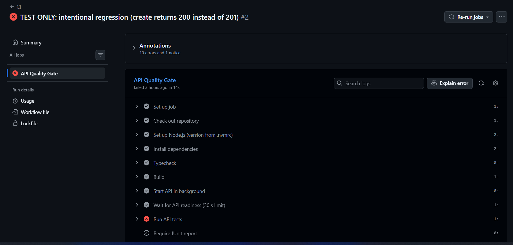
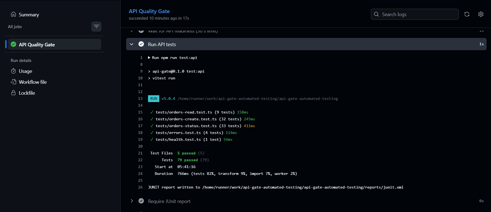

# API Gate — Automated API Testing & CI Quality Gate

API Gate is a small portfolio project that demonstrates automated HTTP API testing and a GitHub Actions quality gate. A sample order API is built, started, and tested over real HTTP on every pull request and push to `main`. If any required step fails, the `API Quality Gate` job fails and diagnostics are uploaded.

The API is only a test target. The focus is the testing and CI pipeline around it.

## Features

- 79 automated HTTP tests that run against a separately started API process
- Request validation (Zod) with one consistent JSON error format
- Order creation and status-transition business rules
- CI that installs, typechecks, builds, starts the API, checks readiness, and runs the tests
- Uploaded diagnostics: JUnit test report and API log (kept 14 days)
- `API Quality Gate` configured as a required check on `main` through a repository ruleset

## Technology

Node.js 24 · TypeScript (strict) · Express 5 · Zod · Vitest (using Node's built-in `fetch`) · GitHub Actions · npm

## How the quality gate works

The workflow in [`.github/workflows/ci.yml`](.github/workflows/ci.yml) runs a single job named **API Quality Gate**:

1. Install dependencies with `npm ci`
2. Typecheck and build
3. Start the built API in the background, logging to `api.log`
4. Wait for `GET /health` (30-second limit; fails early if the process has died)
5. Run the API tests with `npm run test:api`
6. Upload the JUnit report and API log, even when a step failed, then stop the API

A failing step fails the job; nothing in the workflow hides a failure. The `main` ruleset lists `API Quality Gate` as a required check (confirmed through GitHub's API). Blocking a merge on a red check has not been independently tested.

### What it looks like

**Failing gate.** An intentional regression (`POST /api/orders` returning 200 instead of 201) on a throwaway branch. The test step fails, the report check is skipped, and the log and artifact steps still run ([run 38672991054](https://github.com/edzarquiza/api-gate-automated-testing/actions/runs/38672991054)):



**Passing gate.** The final run on `main`, with all 79 tests passing ([run 38688103670](https://github.com/edzarquiza/api-gate-automated-testing/actions/runs/38688103670)):



## Run locally

Requires Node.js 24 (see `.nvmrc`).

```bash
npm ci
npm run typecheck
npm run build
```

The tests call a running API, so use two terminals:

```bash
npm start          # terminal 1: API on http://127.0.0.1:3000
npm run test:api   # terminal 2: runs the 79 tests, writes reports/junit.xml
```

The server reads `PORT` and `HOST` (defaults `3000` and `127.0.0.1`). The tests read `API_BASE_URL`, default `http://127.0.0.1:3000`, and refuse non-local hosts unless `ALLOW_NON_LOCAL_API=true`. If the API is not running, the test command fails immediately with a clear message.

## API endpoints

| Method | Path | Purpose |
|---|---|---|
| GET | `/health` | Health check used by CI readiness |
| GET | `/api/orders` | List orders |
| GET | `/api/orders/:id` | Get one order |
| POST | `/api/orders` | Create an order (201) |
| PATCH | `/api/orders/:id` | Change an order's status |

Status moves are `pending → paid | cancelled`, `paid → shipped | cancelled`, `shipped → delivered`. Other moves return 409. The server computes `totalCents`; clients cannot set it. Details are in [`ARCHITECTURE.md`](ARCHITECTURE.md).

## Test coverage

The 79 test cases cover the health check, order listing and retrieval, valid creation, input validation (missing, wrong-type, out-of-range and unknown fields), malformed JSON, oversized bodies, unknown and invalid IDs, server-computed totals, every legal and illegal status transition, and a consistent error format. Each test creates its own order, so tests do not depend on seed data or on each other.

## Scope and limitations

- Order data is in memory and resets when the API restarts. There is no database and no authentication.
- **No deployment job exists.** Preventing deployment after a failed gate is not implemented or demonstrated.
- Not tested on GitHub: readiness timeout, workflow cancellation, graceful shutdown on Linux, and manual workflow runs.

## Verification evidence

Historical GitHub Actions runs. They show these scenarios worked, not that every failure path has been tested.

| Scenario | Run |
|---|---|
| Initial passing run | [38672309662](https://github.com/edzarquiza/api-gate-automated-testing/actions/runs/38672309662) |
| Regression (create returns 200 instead of 201): gate fails | [38672991054](https://github.com/edzarquiza/api-gate-automated-testing/actions/runs/38672991054) |
| Regression fixed: gate passes | [38673153813](https://github.com/edzarquiza/api-gate-automated-testing/actions/runs/38673153813) |
| API startup crash: gate fails within seconds | [38673760588](https://github.com/edzarquiza/api-gate-automated-testing/actions/runs/38673760588) |
| Startup fixed: gate passes | [38674236917](https://github.com/edzarquiza/api-gate-automated-testing/actions/runs/38674236917) |
| Final run on `main` | [38688103670](https://github.com/edzarquiza/api-gate-automated-testing/actions/runs/38688103670) |

The experiments ran on throwaway branches ([PR #1](https://github.com/edzarquiza/api-gate-automated-testing/pull/1) and [PR #2](https://github.com/edzarquiza/api-gate-automated-testing/pull/2)), which were closed without merging.
